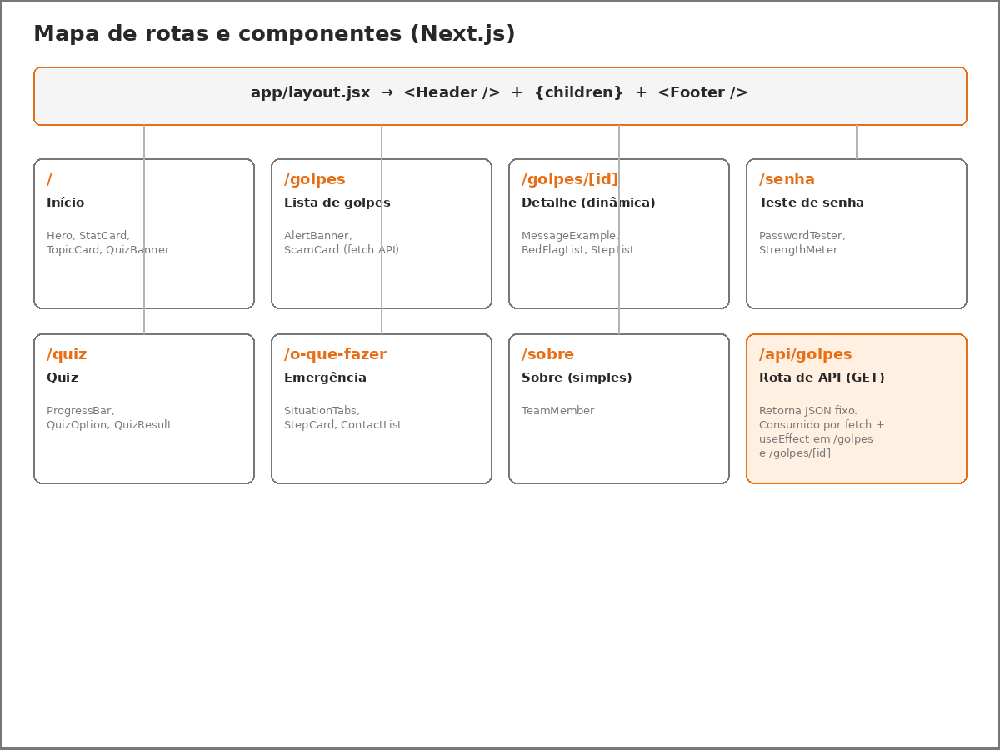
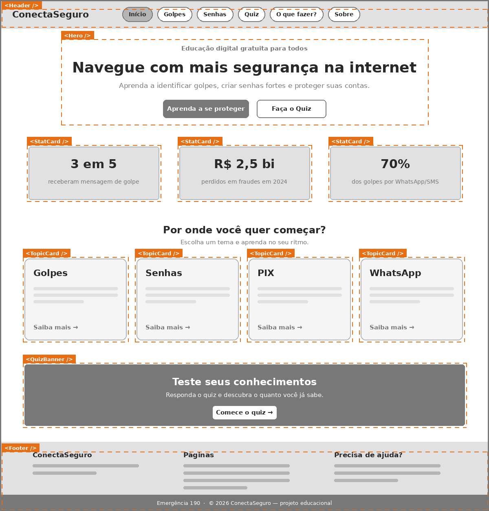
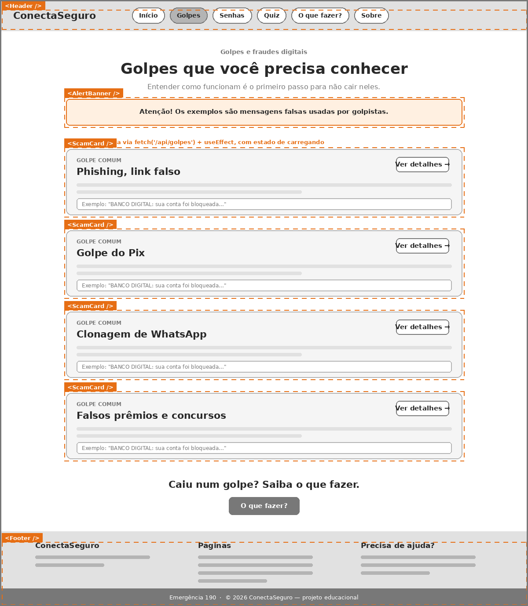
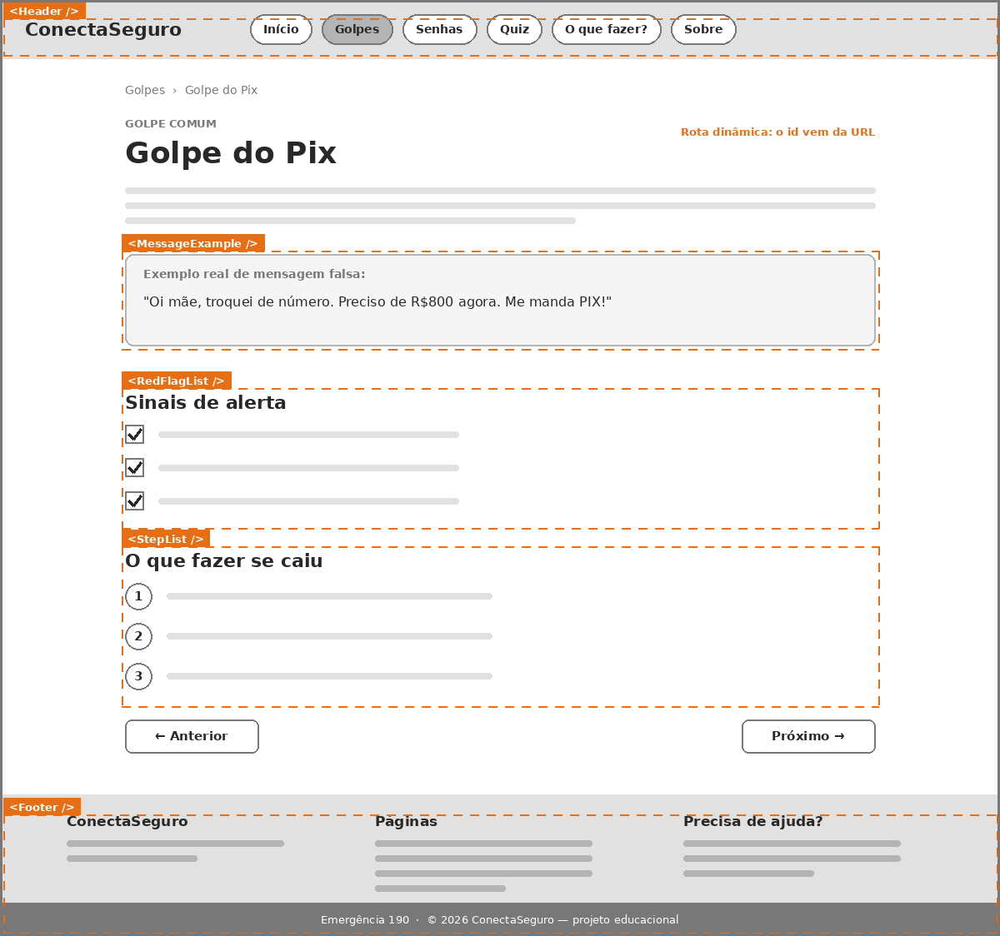
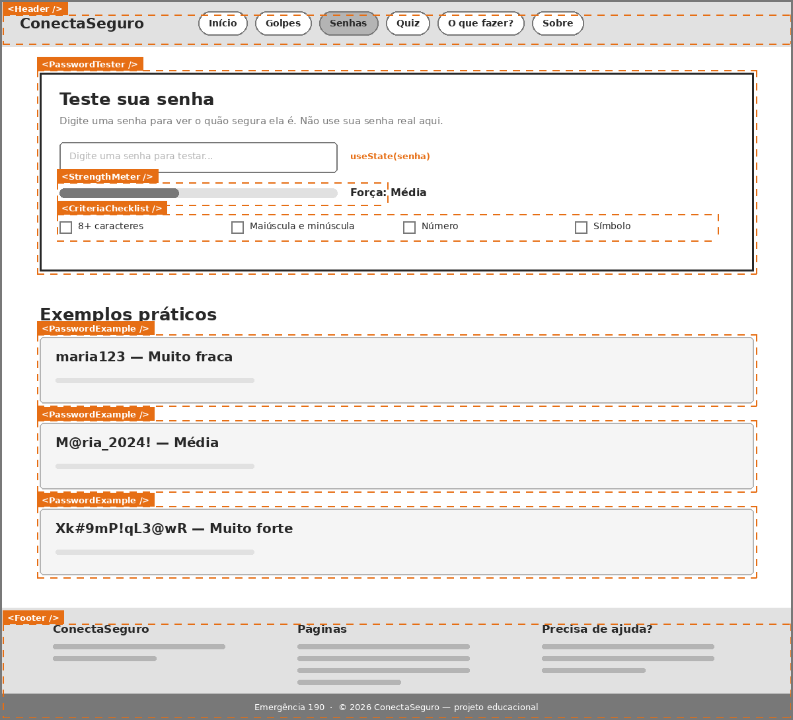
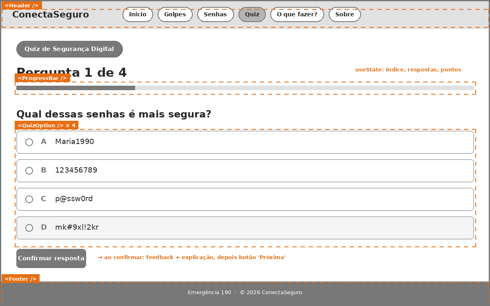
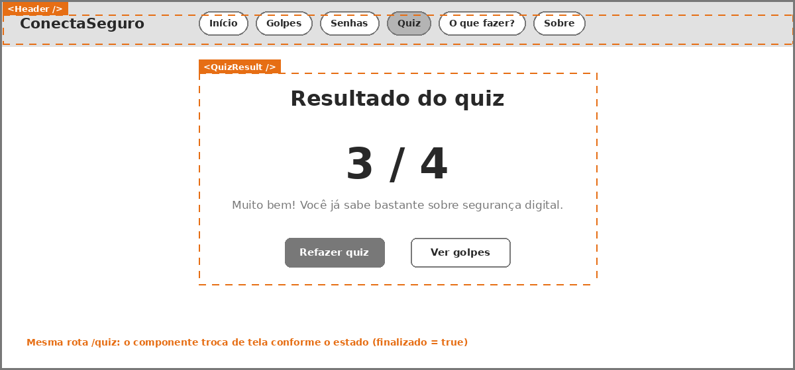
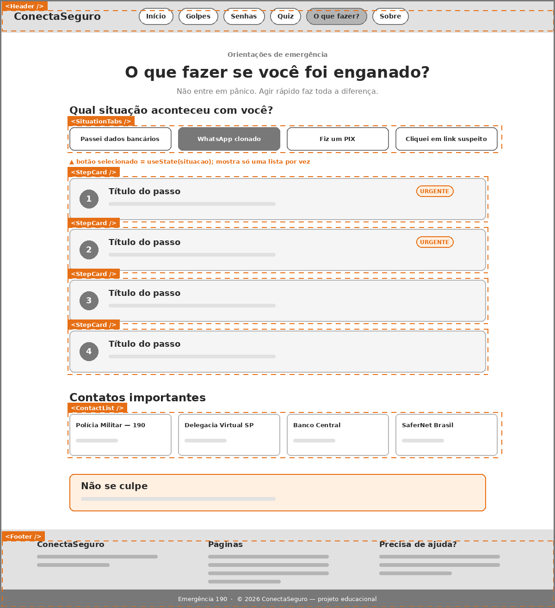
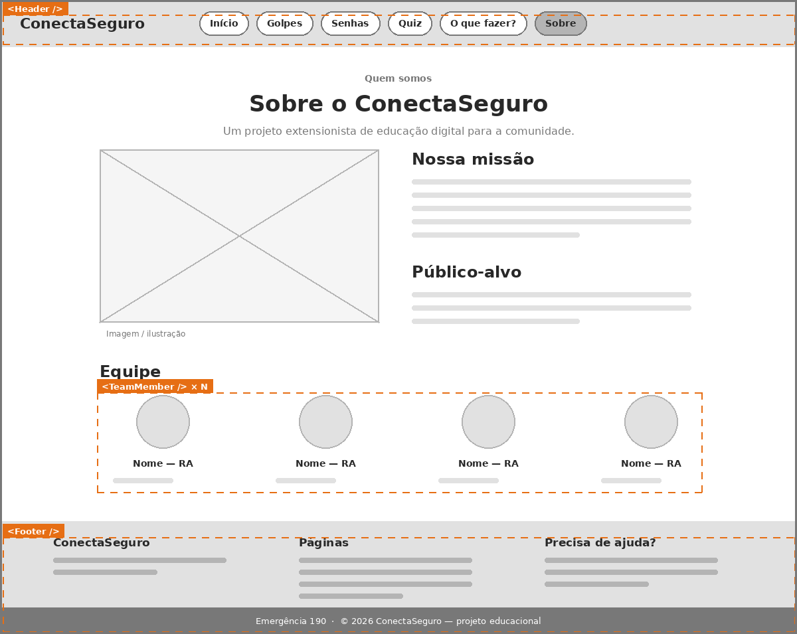

# ConectaSeguro (Projeto 2: Borboleta)

Site de educação digital gratuita sobre **segurança na internet**. Aqui a gente ensina de um jeito simples como reconhecer golpes, criar senhas fortes e saber o que fazer quando algo dá errado.

Este projeto é a continuação do Projeto 1 (feito em HTML, CSS e JS puro). Agora estamos migrando tudo para **Next.js com React**.

**Repositório:** https://github.com/Woss23/ConectaSeguro

> **Status:** Check-in 2 (migração do HTML e CSS para Next.js). Os próximos passos estão na seção [Roadmap](#roadmap).

---

## Integrantes

| Nome completo | RA |
|---|---|
| Andre Elias Lemos Caputo | 10414551 |
| Paulo Cezar | 10780379 |
| Pedro Morais da Silva | 10771425 |
| Rafael Henrique Woss | 10771377 |

---

## Ideação

### De onde veio a ideia?

Todo mundo conhece alguém que já recebeu mensagem de golpe: "sua conta foi bloqueada", "mãe, troquei de número, me manda um PIX", "você ganhou um prêmio". Muita gente cai não por falta de inteligência, mas porque ninguém explicou como esses golpes funcionam.

Pensamos então num site que explicasse isso **sem termos difíceis** e **sem cobrar nada**.

### Qual problema queremos resolver?

- Pessoas que não sabem identificar mensagens falsas.
- Pessoas que usam senhas fracas (tipo `maria123`) sem saber que são fáceis de adivinhar.
- Pessoas que, depois de cair num golpe, não sabem o que fazer primeiro (e o tempo importa muito).

### O que o site tem?

| Página | O que faz |
|---|---|
| Início | Apresenta o site e leva para os temas principais |
| Golpes | Lista os golpes mais comuns, com exemplos de mensagens falsas |
| Detalhe do golpe | Explica um golpe específico: como funciona, sinais de alerta e o que fazer |
| Senhas | Campo para testar a força de uma senha e exemplos de senhas boas e ruins |
| Quiz | Perguntas rápidas para testar o que a pessoa aprendeu |
| O que fazer | Passo a passo para cada situação (PIX, WhatsApp clonado, link suspeito etc.) |
| Sobre | Quem somos e por que o projeto existe |

---

## Parte extensionista

**Público-alvo:** familiares, estudantes e pessoas mais velhas.

**Como o site ajuda a comunidade:**

- É gratuito e não pede cadastro.
- Usa linguagem simples, sem "tecniquês".
- Mostra exemplos reais de mensagens de golpe para a pessoa aprender a reconhecer.
- Tem uma página só para emergências, com telefones e passos urgentes.

**Como vamos levar até o público:** apresentação para grupos de pessoas, compartilhamento do link e coleta de feedbacks.

>  O site é um projeto educacional. Não somos banco nem órgão do governo.

---

## Protótipos (wireframes)

Os wireframes são de baixa fidelidade (só cinza, para focar na estrutura). Os retângulos **laranja tracejados** mostram os **componentes React** que vamos criar, e as anotações laranja indicam onde vamos usar `useState`, `useEffect` ou `fetch`.

### Mapa de rotas e componentes


### Início (`/`)


### Lista de golpes (`/golpes`)


### Detalhe do golpe (`/golpes/[id]`)


### Teste de senha (`/senha`)


### Quiz (`/quiz`)


Tela de resultado (mesma rota, só muda o estado):



### O que fazer (`/o-que-fazer`)


### Sobre (`/sobre`)


### O que mudamos em relação ao Projeto 1?

- **Golpes virou lista + detalhe.** Antes era uma página enorme com todos os golpes. Agora a lista fica em `/golpes` e cada golpe tem sua página em `/golpes/[id]`.
- **"O que fazer" ficou com abas.** Antes todas as situações apareciam empilhadas. Agora a pessoa escolhe a situação e vê só aquele passo a passo.
- **Criamos a página Sobre**, que faltava.
- **Menu, rodapé e estilo iguais em todas as páginas.** No Projeto 1, a página "O que fazer" estava sem o estilo das outras.

---

## Por que migrar para React/Next.js?

No Projeto 1 a gente copiava o mesmo menu e o mesmo rodapé em **cada arquivo HTML**. Se quiséssemos mudar uma palavra no rodapé, tínhamos que mexer em 5 arquivos.

Com React isso muda:

- **Componentes reutilizáveis:** criamos o `Header` e o `Footer` uma vez só e usamos em todas as páginas. O mesmo vale para o card de golpe, as opções do quiz etc.
- **Estado (`useState`):** o quiz, o teste de senha e as abas de "O que fazer" mudam sozinhos na tela, sem a gente ficar buscando elementos no HTML com JavaScript puro.
- **Rotas prontas no Next.js:** cada arquivo dentro da pasta de rotas vira uma página. Não precisa configurar nada.
- **Rota dinâmica:** uma única página `/golpes/[id]` serve para todos os golpes. Antes teríamos que criar um HTML para cada um.
- **API dentro do próprio projeto:** os dados dos golpes ficam num JSON e são entregues por uma rota de API, em vez de estarem escritos direto no HTML.

---

## Check-in 2: migração para Next.js

Neste check-in pegamos o HTML e o CSS do Projeto 1 e passamos para um projeto Next.js (usando o **Pages Router**). O JavaScript do Projeto 1 (quiz, teste de senha e abas de "O que fazer") **ainda não foi migrado**: ele vira `useState`/`useEffect` no Check-in 3. Por isso, por enquanto, o quiz mostra as 4 perguntas ao mesmo tempo e o campo de senha ainda não avalia nada.

### Estrutura do projeto

```
conectaseguro/
├── components/
│   ├── Header.js        menu do topo (igual em todas as páginas)
│   ├── Footer.js        rodapé, emergência 190 e copyright
│   └── Layout.js        junta Header + conteúdo + Footer e define o título
├── pages/
│   ├── _app.js          carrega o styles/globals.css
│   ├── _document.js     define o idioma da página (pt-BR)
│   ├── index.js         rota /
│   ├── golpes.js        rota /golpes
│   ├── senha.js         rota /senha
│   ├── quiz.js          rota /quiz
│   └── o-que-fazer.js   rota /o-que-fazer
├── styles/
│   ├── globals.css      CSS que vale para o site todo (menu, rodapé, body)
│   └── *.module.css     um CSS Module para cada página
├── next.config.js
└── package.json
```

### Como cada página do Projeto 1 virou uma rota

| Projeto 1 | Projeto 2 (Next.js) | CSS da página |
|---|---|---|
| `pagina.html` | `pages/index.js` (`/`) | `Home.module.css` |
| `pagina1.html` | `pages/golpes.js` (`/golpes`) | `Golpes.module.css` |
| `pagina2.html` | `pages/senha.js` (`/senha`) | `Senha.module.css` |
| `pagina3.html` | `pages/quiz.js` (`/quiz`) | `Quiz.module.css` |
| `pagina4.html` | `pages/o-que-fazer.js` (`/o-que-fazer`) | `OQueFazer.module.css` |

### O que mudou do HTML para o JSX

- `class` virou `className`, e `for` virou `htmlFor`.
- Toda tag precisa fechar: `<br>` virou `<br />` e `<input>` virou `<input ... />`.
- Os links `<a href="pagina1.html">` viraram `<Link href="/golpes">` (do `next/link`), para trocar de página sem recarregar tudo.
- Aspas e apóstrofos dentro do texto viraram `&quot;` e `&apos;`.
- O `<head>` de cada página virou o `<title>` dentro do `Layout`, usando `next/head`.
- O menu e o rodapé, que eram copiados em cada HTML, agora existem uma vez só (`Header` e `Footer`).

### O que mudou do CSS

- O `global.css` virou `styles/globals.css` e é carregado uma vez no `_app.js`.
- O CSS de cada página virou um **CSS Module**. Dentro dele, os estilos só valem para aquela página, então nomes iguais em páginas diferentes (como `.botao`) não se misturam.
- Como o CSS Module não aceita seletor só de tag (como `main` ou `button`), demos classes a esses elementos. Exemplo: `main > section:first-child` virou `.introducao`.
- Os nomes de classe com hífen (`caixa-quiz`) viraram camelCase (`caixaQuiz`), porque no JSX usamos `styles.caixaQuiz`.
- As classes repetidas `.card1`, `.card2`, `.card3` e `.card4` viraram só `.card`.

### Ajustes pequenos que fizemos na migração

- Na página "O que fazer" e em "Golpes", os botões que só levavam a outra página viraram `<Link>` com o estilo de botão.
- O quiz e a página "O que fazer" usavam menu e rodapé próprios (ou nenhum). Agora todas as páginas usam o mesmo `Header` e `Footer`.
- Os ícones da página "O que fazer" estavam vazios no HTML do Projeto 1, então não foram migrados.
- A área de resultado do teste de senha (`<p id="resultado">`) volta no Check-in 3, junto com o `useState`.

---

## Tecnologias

- Next.js (Pages Router)
- React (apenas `useState` e `useEffect`, sem Context API)
- CSS Modules + `styles/globals.css` (sem Tailwind)
- Git e GitHub

---

## Como rodar

```bash
git clone <link-do-repositorio>
cd <pasta-do-projeto>
npm install
npm run dev
```

Depois é só abrir `http://localhost:3000` no navegador.

---

## Uso de Inteligência Artificial


| Ferramenta | Para que usamos |
|---|---|
| Claude (Anthropic) | Ideação, sugestão de como dividir o site em rotas e componentes, geração das imagens dos wireframes a partir dos prints do site do Projeto 1 e, no Check-in 2, apoio na conversão do HTML e CSS do Projeto 1 para JSX e CSS Modules |

---

## Roadmap

- [x] **Check-in 1:** ideação e protótipo (wireframes)
- [x] **Check-in 2:** estrutura inicial em Next.js e migração do HTML/CSS
- [ ] **Check-in 3:** conversão para componentes React e interatividade básica
- [ ] **Check-in 4:** rotas simples e dinâmica
- [ ] **Check-in 5:** rota de API pronta e consumo via `fetch`
- [ ] **Entrega final:** README completo, projeto funcionando e apresentação
- [ ] _(opcional)_ Deploy na Vercel


